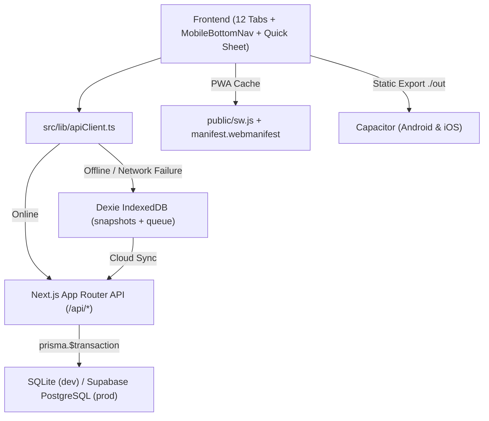

# System Architecture

## High-Level Overview

UAS combines a responsive Next.js App Router frontend, atomic Prisma-backed REST API routes, an IndexedDB (`Dexie.js`) offline mutation queue with Service Worker caching, and Capacitor native wrappers for Android and iOS.

## Layer Separation

1. **Frontend (`src/components/`, `src/app/page.tsx`, `src/app/globals.css`)**
   - `UasAppShell` manages active filters (project, harvest cycle, currency), bilingual RTL/LTR direction (`src/lib/i18n.ts`), themes (`emerald`, `dark`, `royal`), modals (`VoucherModal`, `LoginModal`), and mobile ergonomics (`MobileBottomNav`, `+` FAB, `#mobileQuickSheet`, `412px` mobile simulator).
   - 12 tab modules under `src/components/tabs/` cover Dashboard, Projects, Expenses, Workers, Sales, Customers, System, Treasury, Inventory, Audit, Mobile, and Coding Agent Prompt.
   - `src/lib/excelExport.ts` generates multi-sheet RTL `.xlsx` workbooks via SheetJS (`xlsx`).

2. **Backend (`src/app/api/`, `src/lib/serverBootstrap.ts`, `src/lib/prisma.ts`)**
   - 17 Route Handlers execute mutations atomically inside `prisma.$transaction()`.
   - Period locks (`HarvestCycle.isLocked`) block direct edits/deletes with HTTP `423 HARVEST_LOCKED`, requiring either unlocking or posting an `AdjustmentEntry`.
   - Every mutation writes a hashed entry to `ImmutableAuditLog`.

3. **Offline-First & Native Mobile (`src/lib/offlineDb.ts`, `public/sw.js`, `capacitor.config.ts`)**
   - `Dexie` stores the latest `UasBootstrapState` snapshot and queues pending mutations when offline.
   - `scripts/build-capacitor.mjs` creates a static Next.js export (`CAPACITOR_EXPORT=1`) in `./out` and syncs assets to `android/` and `ios/` without removing API routes from the repository.

